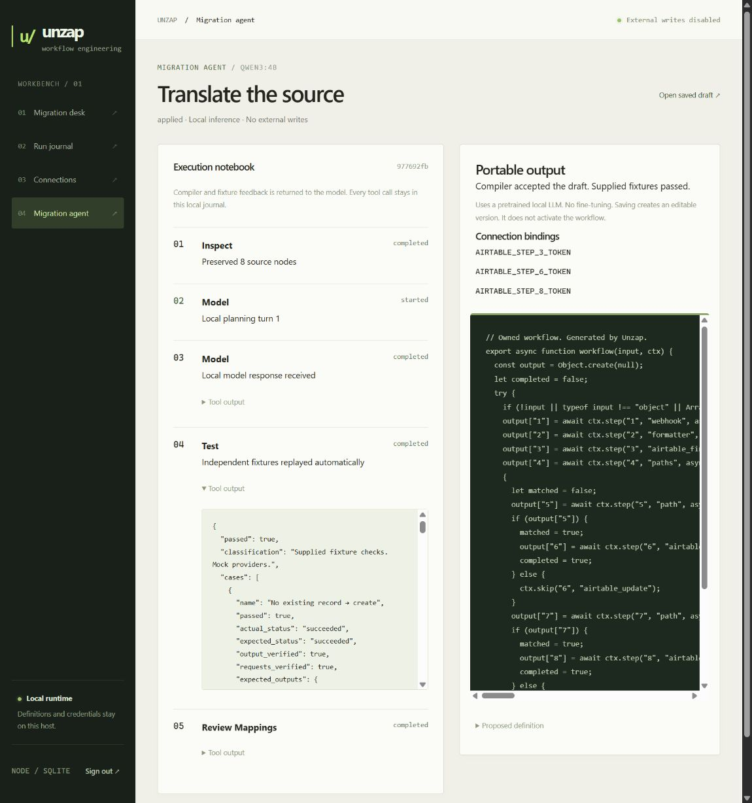

# Unzap

**[Try the guided demo](https://zulfkicar.github.io/apps/unzap/)** · **[Explore the engineering](https://zulfkicar.github.io/apps/unzap/#engineering)**

The local trained model also has a recorded [AutomationBench compatibility probe](docs/automationbench-2026-10-10.md). It passed 0/6 foundational tasks under the native tool-call protocol. This is a preserved negative result, not a full benchmark score.

Import a Zapier JSON export, review its conversion, and leave with a code workflow you own.

Unzap is a self-hosted migration control room. It reconstructs workflows, proposes supported adapters, helps you bind fresh credentials, runs behavioral fixtures, and exports a standalone Node.js project. The same generated JavaScript is executed by the control app and the exported runtime.

Try the **portfolio onboarding demo** at `http://127.0.0.1:8874/demo/`. It needs no control token or provider accounts. Follow the sample migration, review mappings, assign a simulated account, replay both branches and a write failure, then download the generated workflow. A separate engineering view explains the full runtime and trained model.

Visitors can also choose local Zap JSON exports, up to 4 MB and 200 workflows. The browser uses the production importer, validator, compiler and request adapters in a Web Worker. Files stay in memory and are never uploaded or persisted. API calls and accounts are simulated, and the trained model does not run in this public demo. The downloaded workflow needs the runtime context and is not a standalone deployment.

Rebuild the committed browser engine with `npm ci && npm run build:demo` after changing core source modules. To stage the static demo into the portfolio checkout, run `node scripts/build-demo.mjs ../github-site/apps/unzap`. See [onboarding verification](docs/onboarding-demo-2026-10-10.md).



## Run locally

Node 24.15 or Docker. There are no npm runtime dependencies.

```sh
# Windows with WSL Docker
wsl docker compose -p unzap up --build -d
wsl docker compose -p unzap exec app cat .data/control/login-token

# Or Node
npm start
```

Open http://127.0.0.1:8874 and sign in with the installation token. The Docker port is bound to loopback. The token, database and vault key persist in a Docker volume. With Node, they live in `.data/control`.

The three starter workflows are original synthetic examples. No run history is invented. Choose **Approved expense → record & notify**, run its three fixtures, inspect the requests, then activate it in mock mode. A mock activation never contacts an external service.

For a complete import demonstration, upload `fixtures/maintenance-alert.json`, select its Slack step, review the proposed mapping and save. Add a representative test event and compare its outgoing request before deployment.

## Migration flow

1. **Import:** bulk `{metadata, zaps}`, workflow arrays, an individual node dictionary or a ZIP containing zapfile.json. ZIP checksum, compression and expanded-size limits are checked without extracting files. Up to 50 MB expanded, 10,000 workflows and 500 steps per workflow. Definitions stay on the host. Nothing is sent to an AI provider.
2. **Review:** every source node, parent link and unknown action remains visible. Common Airtable create-record and Slack channel-message contracts receive proposed mappings. Unknown options block automatic proposals. Proposals require explicit approval.
3. **Configure:** guided fields for HTTP, Slack, Airtable, scalar filters and output mappings. JSON remains available for advanced parameters. Credentials are named bindings, never copied Zapier connection IDs. Static credentials detected in imports become required bindings and their values are discarded.
4. **Test:** authored input events, expected outcomes and exact method/URL/body receipts. All fixture tests use deterministic mocks. A version change invalidates previous checks. Activation requires every fixture to pass, including a successful case with expected request receipts.
5. **Run:** mock replay, bearer-authenticated webhook activation, durable successes, filtered and held runs, step receipts, safe resume and manual reconciliation of uncertain writes. Activations pin a version, so draft edits do not change the deployed workflow.
6. **Own:** download an editable `workflow.mjs`, runtime modules, environment template, Dockerfile and Compose setup. It runs without a Zapier account or SDK. The CLI emits the same durable runtime.

## Supported contracts

| Action   | Implemented behavior                                                                                                      |
| -------- | ------------------------------------------------------------------------------------------------------------------------- |
| Webhook  | JSON object, separate bearer token, required idempotency key                                                              |
| Filter   | Positive scalar exact, contains, starts/ends, numeric greater/less and boolean rules. AND within groups, OR across groups |
| Mapping  | Explicit object output with typed whole-field references                                                                  |
| HTTP     | GET/POST/PUT/PATCH/DELETE, JSON, simple form or raw serialization. No redirects or automatic write retries                |
| Slack    | `chat.postMessage` with explicit channel/text and optional unfurl setting. Checks `ok` and returns a normalized receipt   |
| Airtable | Single-record creation, explicit base/table/field object and fresh token. Returns the created record                      |

Reference parsing supports legacy `{{123__field}}` and modern `{{=gives["123"]["field"]}}` paths without eval. Only ancestor outputs are legal. Unique copied/replaced source IDs can be resolved from export metadata. Ambiguous aliases remain review issues. Whole-field references preserve types. Missing paths hold execution.

The latest contracts also support sequential nested Paths, rule/always/fallback branches, scalar negative/existence/date filters, selected text/list/arithmetic/date formatters, Airtable find/update and HTTP query/Basic authentication. See [the expanded contracts](docs/agent-migration.md#current-contract-expansion) for precise limits. Delays, scheduling, polling, loops, arbitrary JavaScript/Python steps and unknown expressions remain blocked. This is not an all-app converter.

## Reliability and privacy

SQLite WAL stores versions, fixtures, checks, runs, idempotency claims and step journals. Claims are recorded before execution. Completed steps are reused on resume. A restart turns interrupted external-action steps into uncertain holds. Users must verify the destination and record its receipt before resuming. This prevents blind retries, not exactly-once delivery to third-party APIs.

AES-256-GCM encrypts workflow definitions, credentials, fixture payloads, inputs and outputs. The key is kept on the same host. Names, IDs and status metadata remain plaintext. Back up the key and database together. Authentication values are redacted from displayed receipts. Business data can still be sensitive. Review generated projects before publishing them.

This is a single-operator application. The control UI uses a token and HttpOnly, SameSite session cookie, same-origin mutation checks and an explicit Host allowlist. Remote deployments need HTTPS, correctly configured trusted hosts, backups and access controls. Hostname allowlists constrain outbound requests but are not a substitute for an egress firewall or DNS isolation on an untrusted network.

Live execution is disabled by default. Set `ENABLE_LIVE=true`, `ALLOWED_HOSTS=slack.com,api.airtable.com` and configure fresh bindings only after sandbox validation. Storing a token does not verify its scopes. No actual SaaS writes have been used in project verification.

Third-party API, infrastructure and maintenance costs still apply. Reduced Zapier tasks are not automatically cash savings unless the retained pricing tier changes.

## Verification and architecture

```sh
npm test
wsl docker compose -p unzap exec app npm test
npm run demo
node src/cli.js replay fixtures/webhook-filter-http.json --out .data/demo --input fixtures/input.json
node src/cli.js inspect /path/to/private-export.json --out .data/inventory.json
```

Tests cover typed references, graph blockers, import proposals, exact request construction, encryption tampering, concurrent duplicates, persisted idempotency, safe resume, uncertain-write reconciliation, restart recovery, auth/activation gates and an exported project's independent boot and restart.

See [architecture](docs/architecture.md) and [verification](docs/verification.md). Mock tests do not establish behavioral equivalence with original Zap runs. Real API sandbox comparisons remain necessary before cutover.

Adapter references: [Slack chat.postMessage](https://docs.slack.dev/reference/methods/chat.postMessage/) and [Airtable create records](https://www.postman.com/airtable/airtable-web-api-workspace/request/dq3ike8/create-records). Filter grouping follows [Zapier's AND/OR guidance](https://help.zapier.com/hc/en-us/articles/8495943702285-What-s-the-difference-between-and-and-or-logic-in-filters-and-paths).
## Latest workbench verification

The local migration agent and expanded branch/formatter/Airtable contracts are described in [agent migration](docs/agent-migration.md). The application supports the original pretrained Ollama agent and an opt-in trained 7B translator through llama.cpp, with compiler feedback and independent fixture gates. It produces editable drafts and portable projects. See [local trained-model setup](docs/trained-translator-local.md).

A separate [CPU LoRA experiment](finetune/README.md) trains a small workflow translator and compares its raw generations with the frozen base model using compilation and mocked behavioral checks. The [run report](docs/fine-tuning-2026-10-10.md) records results and limits. Its adapter is experimental and has not replaced the application's 4B agent.

The completed [7B export-translation experiment](docs/fine-tuning-7b-2026-10-10.md) uses sanitized real-export structures, held-out graph families and a separate source control-flow oracle. Its adapter passes 78/80 conversion tasks and 19/20 unsupported-action cases, including 32/33 branch tasks. Recorded metered usage increased by about $6.78 within a $15 budget. The corpus and checkpoint stay private and ignored by Git. The trained-model overlay adds exact source-contract checks and blocks unsupported adapters before inference. Local GGUF performance is verified separately from this offline NF4 benchmark.

The earlier adapter pass recorded 46 passing regressions, two successful local-model pilot workflows, and 164 actual export definitions that can compile once their mapping reviews are resolved. Only 14 of those need no mapping approval. See [adapter and agent verification](docs/verification-agent-and-adapters-2026-10-10.md) for the coverage boundaries and failed-pilot record.

The trained local integration now passes 67 regressions. Fresh CPU inference passed an application migration with both find-or-create outcomes and two held-out branch structures. The resulting draft remains inactive, and all six existing workflow versions and activation settings were preserved. These are mock behavioral checks, not live SaaS verification. See [fresh local results](docs/trained-translator-local.md#fresh-local-verification-2026-10-10).

The 2026-10-10 pass adds a source graph, typed field selectors, reviewed raw Slack chat.postMessage mappings, thread/rich-message validation and regressions derived from the actual export contracts. See [latest verification](docs/verification-2026-10-10.md). Run `node scripts/verify-export-corpus.mjs /path/to/private-backup.zip` for a local structure-only corpus report.

The subsequent [conversion expansion](docs/conversion-expansion-2026-10-10.md) adds durable public-channel joining, Google Sheets append/sparse-update contracts, numeric tab resolution and webhook child-object extraction. Complete definitions compilable after mapping review increased from 164 to 232. Thirty-one complete sanitized export chains passed mocked request/output fixtures, with one invalid broadcast configuration blocked. Fresh local inference passed 8/8 supported complete export structures, including four branching workflows, and refused 3/4 unsupported cases. The application blocked its false proposal. These cases share the source corpus used for training and do not establish independent generalization or live API parity.

Two additional trained-model conversions exercised the new Sheets and channel-join contracts successfully. Both are available as inactive, tested examples in the local workbench. The latest WSL Docker pass has 73 passing regressions. See [aggregate evidence](docs/conversion-expansion-results-2026-10-10.json).

The [reusable account setup](docs/reusable-accounts-2026-10-10.md) replaces per-step token entry with named accounts, provider-specific guidance, app-filtered selectors and bulk assignment. Known source account IDs share import requirements. Multiple accounts for one app remain supported.

[OAuth sign-in and automatic renewal](docs/oauth-2026-10-10.md) are implemented for Google Sheets, Airtable and Slack. The installation owner registers each provider app once. Users then connect through provider consent. The current suite passes 92 regressions with mocked OAuth providers. Real consent awaits application registration, and Slack requires an HTTPS installation.
