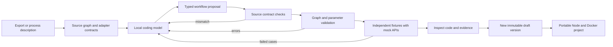

# Unzap: migration compiler and local translation agent

The product takes an existing automation export or a process description and produces an editable, portable workflow project. The visual graph is an inspection surface for that generated program. The deliverable is the code, its integration bindings and its test evidence.

An AI prompt box alone does not distinguish Unzap. The useful product boundaries are:

- Convert existing definitions while retaining their topology and mapping provenance.
- Use model planning to select contracts and repair compiler errors.
- Test requests and outputs against independently supplied examples.
- Hand over ordinary JavaScript, a runtime journal, Docker configuration and environment bindings. The deployed project does not need Unzap or Zapier to be available.
- Keep ongoing operations in code rather than charging through a task-metered service. Hosting and third-party API costs remain.

## Local agent



The base configuration uses pretrained `qwen3:4b` through Ollama. That model has not been fine-tuned on Unzap migrations. The [trained 7B overlay](trained-translator-local.md) loads the completed Unzap adapter through a local llama.cpp service. It uses the frozen training prompt, refuses missing source adapters before inference, and compares supported proposals against the imported adapter contracts before compilation. These are separate profiles with different context and node limits.

The model can inspect, review exact mappings, propose, test and finish. Compilation and independent fixture replay run automatically after proposals or mapping reviews. Imported IDs and parent links cannot be deleted or reparented. Replacements for unimplemented source actions remain review blockers. Source instructions and code are data, not executable capabilities.

Inference is limited to six turns, 50 nodes, 12 KB of initial context, 4,096 context tokens, 1,600 generated tokens per call, four CPU threads and three minutes per call. Only local Ollama endpoints are allowed. There is one active model job. Jobs are encrypted in SQLite, record every tool result, support cancellation and mark unfinished work as interrupted after restart.

Saving a completed draft creates a version. It does not activate it. A model cannot enable live API calls, select production credentials or deploy code. Credentials are named bindings and are entered separately.

Run locally:

```sh
docker compose --profile agent up --build -d
docker compose exec ollama ollama pull qwen3:4b
```

The Ollama service binds to `127.0.0.1:11434`, disables cloud models, limits CPU and memory, and keeps downloaded models in its own Docker volume. Images should be pinned to reviewed digests before a deployment.

## Local fine-tuning experiment

Collect locally reviewed source-to-definition pairs with independently verified request/response fixtures. Keep failed drafts and repair feedback as separate examples. Split evaluation by workflow family, including held-out adapters and unseen branch combinations. Use the same source-preservation, compilation and behavior gates to compare the base model with a fine-tuned model. Do not count compiler acceptance, status-only fixtures or model-authored expectations as proof of semantic equivalence.

The separate [CPU LoRA pilot](../finetune/README.md) trains a 0.5B translator on fictional, contract-checked examples. It uses a compact proposal protocol and is evaluated against the same frozen base weights. The [dated report](fine-tuning-2026-10-10.md) records generation and behavior results. That pilot adapter has not replaced the application agent.

The completed [7B Modal experiment](fine-tuning-7b-2026-10-10.md) trained on sanitized real-export structures, supported segments and synthetic variants. The original private ZIP was not uploaded. Its saved adapter now has a local inference path. Offline NF4 benchmark results and fresh local Q4_K_M inference checks are reported separately.

## Current contract expansion

Paths groups, rule/always/fallback branches and nested sequential execution are implemented. False filters skip descendants in their own branch. All matching siblings continue in source order. Unsafe cross-branch references and dependency-error suppression stay blocked.

Filters include positive and negative scalar conditions, existence and date comparisons. Formatters cover split segments, replacement, whitespace/case, length/count, truncation, URL encoding, list selection/lookup/conversion and arithmetic. Date formatting supports explicit ISO/Unix inputs and timezone-aware output. Locale guesses, ambiguous wall clocks and unimplemented regex/formula operations stay blocked.

Airtable supports create, search and update contracts. Search handles missing records and ambiguous results explicitly, preserves field-ID outputs and supports downstream found/not-found branches. HTTP supports explicit query values, safe double-underscore unflattening, array wrapping, simple forms and Basic authentication.

Live provider parity still needs actual sandbox recordings and permissions. Raw export definitions supply source contracts, not independent execution evidence.
