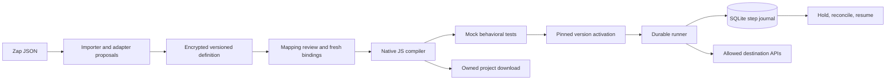

# Architecture

Unzap is a single-operator migration application. The control room and portable runtime share the compiler, adapters and execution journal.

## Modules

| Module                     | Responsibility                                                                                          |
| -------------------------- | ------------------------------------------------------------------------------------------------------- |
| `importer.js`              | Format handling, hashing and secret extraction. Earlier analysis contracts retained as regression tests |
| `import-adapters.js`       | Strict proposals for known source contracts, with review requirements                                   |
| `migration.js`             | Complete node preservation, aliases, ancestor checks, graph validation and native JS generation         |
| `runtime.js`               | Typed references, scalar filters and serialization                                                      |
| `connectors.js`            | API request shapes, deterministic mocks, response adapters, redaction and live transport                |
| `store.js`                 | SQLite schema, encrypted payloads, versions and restart recovery                                        |
| `runner.js`                | Idempotency claims, execution, durable reuse and reconciliation                                         |
| `bundle.js` / `emitter.js` | Standalone packaging. CLI and UI share the runtime                                                      |
| `server.js`                | Authenticated control API, activation gates, webhooks and static UI                                     |
| `public/`                  | Import, guided edits, tests, code, deployment, connections and run operations                           |

## Contracts

Imports retain source actions and source parameters. Their fingerprint registers an import, so re-imports reuse its draft and history. Proposals stay blocked until approved. Unsupported options do not disappear. Compilation supports webhook trees with explicit Paths groups and safe ancestor references. Matching paths execute sequentially. Filters skip descendants within their branch, fallback paths execute only when no other path matches, and skipped steps are journaled. Cross-branch references, ambiguous ordering and dependency-error suppression remain blockers.

Definitions are immutable per version. Edits use optimistic concurrency and create new versions. Tests attach to that version. Activating v1 then editing v2 keeps traffic on v1. Restoring creates a draft rather than mutating history.

The compiler emits an ordinary JavaScript function. Parameters are serialized as data. Expressions are parsed as paths rather than evaluated. Imported code steps never execute in the control app. A downloaded workflow can be edited by its owner and executes as that owner's code.

## External effects

1. A durable claim binds an idempotency key to exact input, mode and version.
2. Each step records running state before its operation.
3. A successful receipt is persisted before later steps execute.
4. Resume reuses successful outputs and executes unresolved safe steps.
5. Missing or unreadable write receipts create uncertain holds. Restarted external-action steps become uncertain too.
6. An operator verifies the destination and records its receipt. That step is then reused without sending it again.

A local transaction cannot atomically commit a third-party API write. An unresolved hold is preferable to blindly repeating it. There is no automatic retry scheduler. If the operator confirms a write did not occur, this release does not offer a bypass to resend it. That needs an audited not-applied resolution flow.

## Next decisions

SQLite and one process keep local operation simple. Multiple replicas need shared leases and fencing. The vault key beside the database protects copied databases but not a compromised host. Remote use requires HTTPS and stronger identity controls. Host allowlists need network isolation for full protection against DNS rebinding.

The local translation agent uses Ollama, constrained proposals, compiler feedback and independent mock fixtures. Agent jobs are encrypted and version-bound. Applying a proposal creates a draft, never activation. See [agent migration](agent-migration.md).

Remaining high-frequency families include native polling/event triggers, Google Sheets, delays, custom code, regex and spreadsheet formulas, and custom business APIs. API sandbox recordings and independent holdout workflows are needed before claiming equivalence. Private exports are not automatically training datasets.
