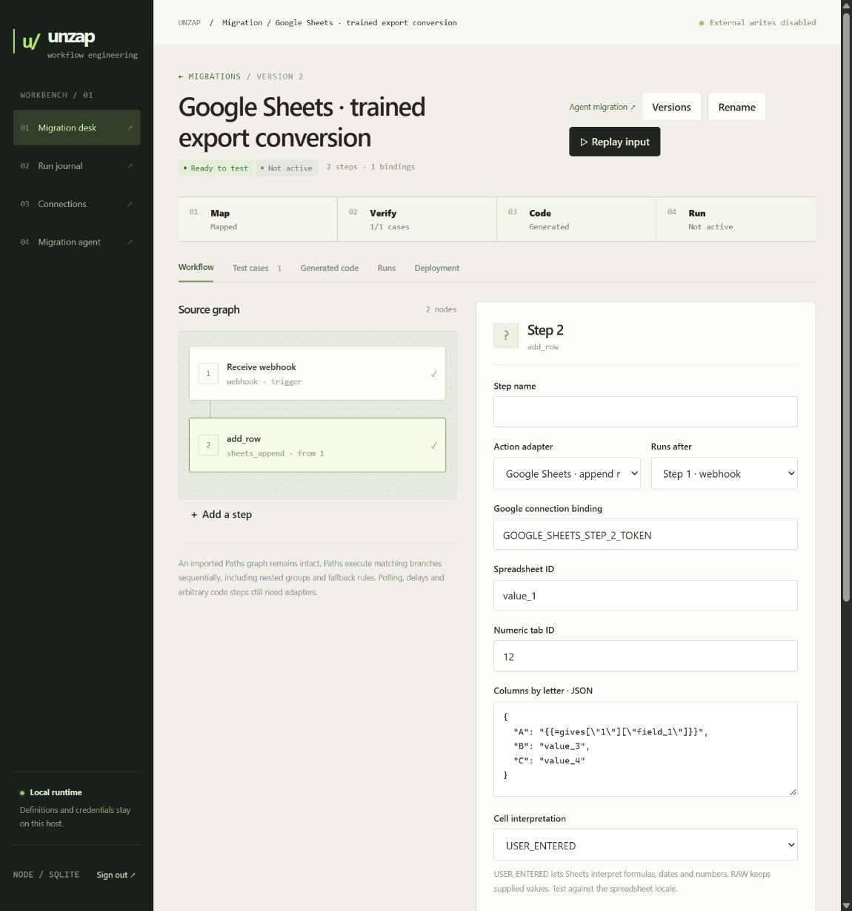

# Export conversion expansion

This pass adds public Slack channel joining, Google Sheets row append/update, and webhook child-object extraction. It prioritizes contracts present in the supplied 4,083-workflow export corpus. Private definitions, credentials, anonymized examples and model responses remain under ignored `.data`. The application remains local with external writes disabled.

## What the new adapters do

**Slack:** a reviewed channel-message mapping can request `join_channel: true`. Generated code first joins the public channel and records a separate durable substep, then posts the message. A confirmed join is reused when safely resuming a rejected post. Interrupted or unconfirmed membership writes become uncertain and require reconciliation. Joining private channels, file uploads, scheduled posts and Zapier edit backlinks remain unsupported. Broadcast replies without a thread timestamp are rejected during import/validation. See [conversations.join](https://docs.slack.dev/reference/methods/conversations.join/) and [chat.postMessage](https://docs.slack.dev/reference/methods/chat.postMessage/).

**Google Sheets:** `add_row` and `update_row` exports using `COL$A` column mappings become `sheets_append` and `sheets_update`. A metadata read resolves the exported numeric tab ID into an escaped A1 title before writing. Metadata is refreshed on resume. Sparse updates address only mapped cells, while appends use a single row with explicit gaps. The runtime checks spreadsheet identity, row/cell ranges and returned values before marking success. A mismatched write receipt is uncertain, never silently retried. The portable project includes the same adapter.

Mappings require a named Google access-token binding. `USER_ENTERED` is the proposed interpretation mode and must be reviewed against the spreadsheet's locale and actual Zap behavior. `RAW` is also available for native workflows. OAuth consent/refresh, header-name mappings, automatic creation on lookup misses, Drive selection and timezone conversion remain pending. See [metadata reads](https://developers.google.com/workspace/sheets/api/reference/rest/v4/spreadsheets/get), [append](https://developers.google.com/workspace/sheets/api/reference/rest/v4/spreadsheets.values/append) and [sparse value updates](https://developers.google.com/workspace/sheets/api/reference/rest/v4/spreadsheets.values/batchUpdate).

**Webhooks:** `key` or `Pick off a Child Key` maps to `child_key`. It selects a literal top-level object key. Missing keys, unsafe keys, scalar values and arrays hold the run. Array-trigger fan-out has no execution adapter yet.

The guided editor exposes the new settings. Fresh bindings, fixtures and activation remain distinct steps. A valid draft is not an active integration.

## Corpus verification

| Measure | Before | After |
| --- | ---: | ---: |
| Complete definitions compilable after mapping review | 164 | 232 |
| Definitions needing no mapping approval | 14 | 15 |
| Source nodes with recognized adapters | 14,530 | 16,030 |

These are structural counts, not deployed workflows or semantic equivalence claims. Every source node and parent link is retained. Unknown actions and unresolved references still block compilation. The improved contracts also reject invalid broadcast settings previously accepted by the structural check.

Thirty-two short complete anonymized export chains were selected for independently constructed request fixtures. Thirty-one passed, covering 20 Sheets chains and 11 Slack-join chains. One was blocked for an invalid broadcast reply with no thread timestamp. No source nodes were removed to obtain a passing result. Shared scalar reference decoding and mocked API receipts limit what this establishes. The independent branch interpreter is used separately for the model evaluation.

The saved 100-response NF4 audit now accepts 74/80 supported proposals, including 32/33 branch proposals, and approves 0/20 unsupported tasks. This is lower than the previous 78/80 acceptance count because the stricter broadcast guard catches four previously accepted training-label examples. The original experiment and checkpoint remain frozen. These labels must be corrected or rejected before a subsequent training run.

The bounded fresh local evaluation is complete:

- Eight supported complete export structures passed source and behavior checks, including four branching structures.
- Three of four unsupported structures received correct refusals. The fourth produced a false proposal. Replaying that proposal through the application confirmed `needs_work`, with zero model calls after unsupported-adapter preflight and no approval.
- Two additional complete exports requiring new adapters passed model translation plus exact request fixtures. Sheets passed on its first turn. Slack initially omitted joining, then repaired the proposal on its second turn after the source guard rejected it.
- All 73 regressions passed in WSL Docker. The two model-generated examples also passed fixtures through the running control API and remain inactive. Six existing workflows retained their versions, activation settings and modes.

See the [aggregate results](conversion-expansion-results-2026-10-10.json). Complete sanitized structures are evaluated without topology variants. The underlying corpus was used for training, so this is integration evidence rather than an independent generalization estimate. Branch payloads and API responses are authored mocks. Original Zap run recordings and live sandbox parity are unavailable.

The substeps exposed two journal/checker defects which are now fixed: step order is persisted rather than inferred from millisecond timestamps, and request-object key order does not affect fixture equality. The additive ordering migration retains old records. A consistent encrypted-database backup was created locally before deployment.

Open the inactive [Sheets example](http://127.0.0.1:8874/#workflow/492fd415-ba60-4006-b133-8ebe27d59ef7) or [Slack example](http://127.0.0.1:8874/#workflow/c3fb3d84-46fe-4848-adb8-afa241ae32d1) to inspect inputs, outgoing requests, generated code and bindings.

## Path to description-driven setup

The product goal is a description-to-integration agent that gathers missing requirements, resolves concrete provider resources, requests scoped credentials, generates owned code, and verifies behavior before an operator deploys it. The model proposes plans and mappings. Versioned integration contracts and the runtime implement execution.

The current trained translator receives the newly added adapter contracts and proposed mappings in its input context. This is capability extension through explicit context, not another fine-tune. New source actions cannot be invented or silently substituted. Description-only drafts have no imported source contract, so a clear requirement specification and independent fixtures matter even more.

The next implementation priorities are:

1. Google OAuth refresh and resource discovery, with read-only connection checks and explicit write confirmation.
2. Sheets lookup/find-or-create and durable delay/schedule adapters, selected by whole-workflow coverage rather than raw action frequency alone.
3. A requirement interview that asks for triggers, destinations, deduplication policy, failure handling and representative inputs before generating a workflow.
4. A corrected next training corpus that includes new adapter contracts, complete workflows, refusal examples, branch coverage and description-to-plan examples. Keep graph families together and evaluate unseen capabilities separately.

No additional Modal compute, fine-tuning spend, cloud upload or external service write is part of this pass.
