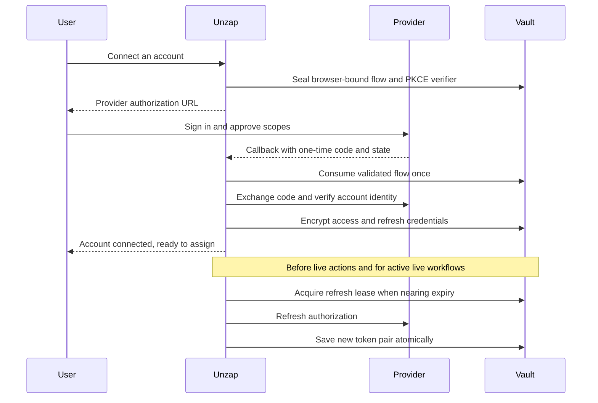
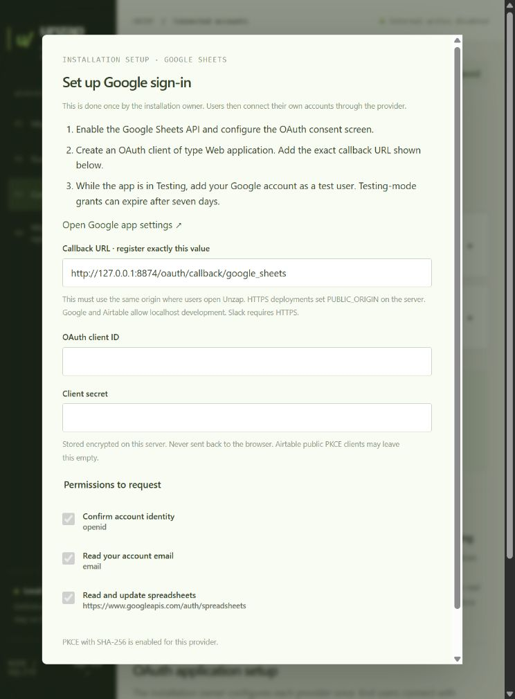

# OAuth sign-in and token renewal

Unzap supports Google Sheets, Airtable and Slack OAuth authorization-code flows. Users sign in on the provider's site, approve access and return to a reusable named account. Personal tokens are an advanced fallback. The installation owner configures the provider application once.

## Installation setup

Open **Connections → OAuth application setup**. Each provider's setup dialog contains the developer-console link, requested scopes and exact callback URL. Client credentials are encrypted in the installation vault. The client secret is never returned to the browser. Leaving it blank when updating the same client preserves it.

For the current local installation, register:

| Provider | Callback | Requirements |
| --- | --- | --- |
| Google | `http://127.0.0.1:8874/oauth/callback/google_sheets` | Web application OAuth client, Sheets API enabled, consent screen and test users configured |
| Airtable | `http://127.0.0.1:8874/oauth/callback/airtable` | OAuth integration, matching callback and registered record scopes. Public PKCE or confidential client |
| Slack | `https://YOUR-DOMAIN/oauth/callback/slack` | HTTPS installation, Slack app with bot scopes. Enable token rotation to receive refresh tokens. Optional PKCE must also be enabled in Slack |

Google and Airtable accept localhost development. Slack requires HTTPS. These are integration connections, not authentication into Unzap itself. The control panel keeps its existing operator authentication.

For HTTPS behind a trusted reverse proxy, set `PUBLIC_ORIGIN=https://YOUR-DOMAIN` in the app's environment. The whole UI and callback must share that origin. Register each `/oauth/callback/PROVIDER` URI exactly. The server uses this explicit configuration rather than trusting forwarded protocol headers. Secure cookies are set when using the configured HTTPS origin. No proxy, public endpoint, DNS or provider app was created in this pass.

Provider references: [Google web-server OAuth](https://developers.google.com/identity/protocols/oauth2/web-server), [Airtable OAuth](https://airtable.com/developers/web/api/oauth-reference), [Slack authorization](https://docs.slack.dev/authentication/installing-with-oauth/), [Slack rotation](https://docs.slack.dev/authentication/using-token-rotation/), [Slack PKCE](https://docs.slack.dev/authentication/using-pkce/).

## Runtime behavior

Callbacks require an unexpired, unused state and the initiating browser's separate HttpOnly, SameSite=Lax OAuth cookie. The normal control session remains SameSite=Strict. Unzap uses PKCE with SHA-256 for Google/Airtable and makes it configurable for Slack's PKCE mode. Token endpoints are fixed server-side, redirects are forbidden, responses are capped and request timeouts are bounded. OAuth codes and PKCE verifiers are consumed once. Logout cancels pending flows.

For real consent, open the whole Unzap installation in a normal browser and keep sign-in and callback in that browser. The OAuth request is deliberately bound to its initiating browser, so moving only the provider authorization link to another browser cannot complete it.

Google/Airtable identity is confirmed through their identity endpoints. Slack requires a bot token with workspace/bot identity. Reconnecting an existing account rejects a different identity and protects concurrent account edits with credential revisions.

The runner renews OAuth credentials before account-based live actions. Mock execution makes no OAuth calls. Maintenance renews expiring accounts used by active live workflows when live execution is enabled. Granted scopes are checked per action, including concurrent actions sharing a refresh. Renewal does not retry business writes.

Rotating refreshes use a database lease and an in-process shared promise. New access/refresh tokens are persisted together with a revision check. Interrupted rotating exchanges become uncertain and require reconnecting, rather than replaying a potentially consumed token. Google transient errors use a persisted 30-second pause before retrying its reusable refresh token. Revoked or expired grants require renewed user consent.

## Verification and current readiness

**92/92 regressions passed in WSL Docker**, including 15 OAuth-focused cases. Mock provider responses cover successful grants for all providers, PKCE, token rotation across restarts, browser/origin checks, replay and expiry, denial, logout, scope checks, concurrent refreshes, stale configuration, account identity, revocation, network interruption, Google retry and the runner's mock/live boundary. Live HTTP tests cover authenticated setup/start and browser-bound cancellation callbacks without making provider calls.

The database was backed up before migration. All nine existing workflows retained their versions, active versions and modes. Existing credentials were preserved. There are currently **zero registered provider clients and zero connected accounts** on the local installation.

Real provider consent, app registration, API permissions and workflow resources are **not yet verified**. The owner still needs to register the applications and enter their client credentials in setup. Google/Airtable are the available localhost validation paths. Slack needs an HTTPS deployment. Google testing-mode authorizations can expire independently of ordinary access-token renewal.

Removing an account forgets its local credential. It does not revoke the provider's remote authorization. Revoke app access in the provider's settings when needed. Exported portable workflow projects never include OAuth clients or refresh credentials. They require their own credential provisioning or execution through the configured Unzap installation.

