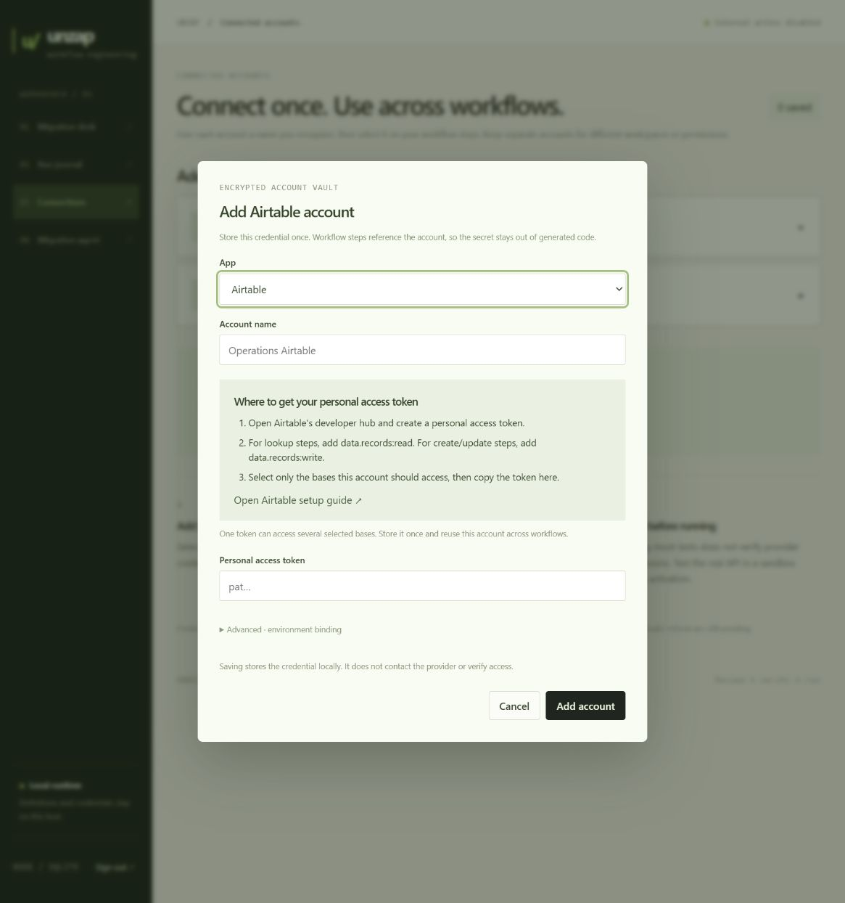

# Reusable connected accounts

The subsequent [OAuth implementation](oauth-2026-10-10.md) adds provider sign-in and automatic renewal. The direct-token instructions below remain available through the advanced fallback. Provider apps must be registered before real OAuth consent can be tested.

Connections now represent named accounts. An account stores one encrypted credential and can be selected by several steps across workflows. Separate credentials for the same app remain separate accounts.

## Add and reuse an account

1. Open **Connections**, then choose Airtable, Slack, Google Sheets or Custom API.
2. Name the account, for example **Operations Airtable**. Follow the provider instructions and paste its credential. App bindings are generated automatically. Advanced HTTP mappings can specify a binding explicitly.
3. Open a workflow step and choose the account from its app-specific dropdown. Save the step, or choose **Assign across steps** to apply it to several steps in one new draft version.
4. Rerun fixtures for the new version. Account assignment retains mapping-review flags and does not modify an active workflow's pinned version.

Airtable setup explains personal access tokens, record read/write scopes and base access. Slack setup explains bot tokens, installation and scopes needed for posting, joining and custom identities. Google Sheets uses a manually supplied OAuth access token for now. Automatic sign-in and token refresh are not implemented. Saving credentials does not verify live access.

Official credential references: [Airtable personal access tokens](https://support.airtable.com/articles/9934989703-creating-personal-access-tokens), [Slack tokens](https://docs.slack.dev/authentication/tokens/), [Google Sheets scopes](https://developers.google.com/workspace/sheets/api/scopes).

## Import and compatibility

Imported nodes with the same nonempty Zapier authentication ID and app share a connection requirement. The source identifier is hashed and is never treated as a credential. Distinct source accounts remain separate. Exports without account identity retain separate requirements until the operator assigns an account explicitly.

Existing workflow versions and bindings are preserved. The additive account-provider migration classifies old Airtable, Slack and Google Sheets bindings by prefix, with other bindings retained as Custom API. It never merges, deletes or rewrites stored credentials. Named account selection does not change source actions or mappings. The trained translator preserves the selected binding when checking source contracts.

Account names can be edited without resupplying the token. Leaving the replacement field blank keeps the encrypted credential. Replacing a credential affects all references to that account, including active versions. An account's app cannot be changed in place. A new account is required for another provider. Explicit bulk assignment rejects mismatched providers and stale workflow versions.

## Verification

The WSL Docker suite passed **77/77 tests**. New checks cover shared source identities, distinct/unknown identities, encrypted account reuse across actions, export bindings, provider mismatch rejection, credential preservation on metadata edits, static module delivery, optimistic assignment and active-version preservation. Provider requests in tests use synthetic credentials and mocked transports.

The live UI was inspected for provider selection, credential instructions, hidden advanced bindings, Google token limitations and Airtable step selection. All nine existing workflow versions, activation settings and modes were preserved. No real account was created or modified. A consistent encrypted database backup was saved locally before migration.

