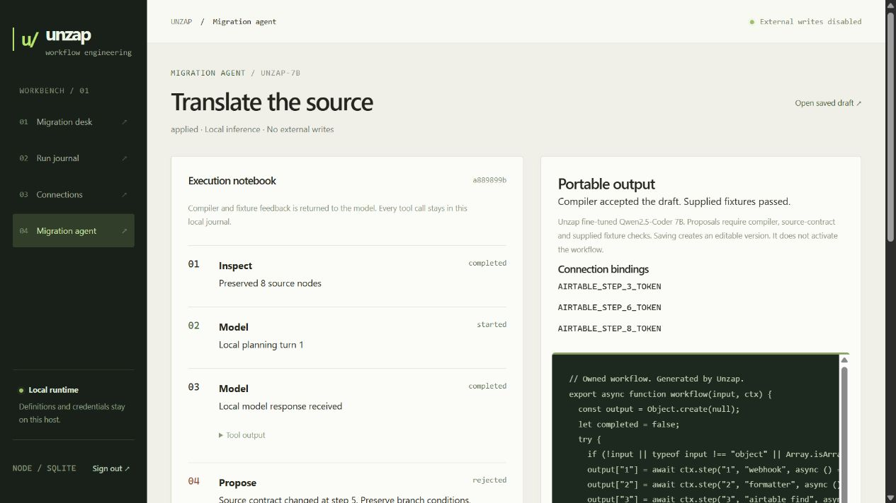

# Running the trained translator locally

The saved Qwen2.5-Coder 7B adapter now has an application path with the same system prompt used for training. It proposes code, then the application checks source topology, action kinds, references, parameters, branch conditions and supplied behavioral fixtures. Unsupported source actions stop before inference. A successful draft must still be saved and configured before it can run.

## Prepare weights

The private adapter must already exist at `.data/finetune/runs/qwen7b-20261010-v2/adapter`. The preparation script verifies its recorded SHA256 and downloads only public Qwen weights and pinned llama.cpp converter files. Nothing is uploaded. Private data and model files stay under ignored `.data`.

```powershell
python -m venv --system-site-packages .data/local-model/venv
.data/local-model/venv/Scripts/python.exe -m pip install -r finetune/local-requirements.txt
python -X utf8 finetune/prepare_local.py --weights
.data/local-model/venv/Scripts/python.exe -X utf8 finetune/convert_local.py
```

The Windows preparation environment reuses the already installed CPU Torch. A fresh machine needs a compatible Torch installation. Conversion creates an 80.8 MB F16 GGUF adapter from the original 161.5 MB checkpoint without altering it. The quantized base is an official Qwen Q4_K_M GGUF, approximately 4.7 GB. This uses a different quantization from the original NF4 training evaluation.

## Start with WSL Docker

```sh
cd /mnt/e/Applications/Portfolio/zap-to-code
docker compose -p unzap -f compose.yaml -f compose.trained.yaml up -d --build
```

If the full registry image downloads slowly, prepare the verified CPU binary and build it locally:

```powershell
python -X utf8 finetune/prepare_local.py --runtime
```

```sh
docker compose -p unzap -f compose.yaml -f compose.trained.yaml -f compose.trained.binary.yaml up -d --build
```

This alternative uses the same pinned llama.cpp build and a pinned Debian-based Node image with its CPU/SSL runtime libraries. The 18 MB official release archive is hash-checked before extraction. It was used for this installation. Keep Ubuntu running while using its Docker services. A hidden idle WSL process was started for this local session, with its PID and start time recorded under `.data/trained-local-verification/wsl-keepalive.json`.

Keep the existing Compose project name `unzap` on this installation so the original control database volume is reused. The overlay starts a pinned llama.cpp image, loads the adapter, uses four CPU threads and a 9 GB memory ceiling, and exposes inference on loopback port 11435. It changes the app's selected provider and profile. Other portfolio services use separate Compose projects.

The trained profile has a 16-node source limit, a 12 KB initial prompt limit and bounded calls. It requests up to 4,096 output tokens with an 8,192-token inference context. Those longer output/context settings differ from the offline benchmark's 2,048-token output cap and 4,096-token training sequences. A response must parse as JSON without syntax or fence repair.

Source-backed proposals must match the deterministic import adapter contracts. Filter group numbers can be renamed without changing their AND/OR partition. Reference spelling can change while referring to the same step and field. Credentials retain the installation's named bindings. Changed business values, destinations, operators, branch modes or reference targets are rejected. Unknown source adapters cannot be approved by a model.

These strict checks can reject a reasonable alternative implementation. The operator can review an editable source definition instead of silently accepting a model rewrite. A natural-language-only task has no source contract to compare, so its behavioral evidence depends on supplied fixtures.

## Verify

```sh
docker compose -p unzap -f compose.yaml -f compose.trained.yaml exec app npm test
```

The recorded-response audit is separate from fresh inference:

```sh
node scripts/audit-trained-integration.mjs
```

It replays the 100 saved NF4 responses through the application gates. The integration initially accepted 78/80 supported proposals. The subsequent adapter pass added a broadcast/thread guard, reducing current acceptance to 74/80, including 32/33 branch proposals. Four old positive examples have invalid Slack broadcast settings and now require correction. The gates approve none of the 20 unsupported tasks, including the trained model's unsupported false proposal. Every approved response also passed the source oracle. This audit does not call the quantized local model or verify live APIs. See [the expansion report](conversion-expansion-2026-10-10.md).

Use the migration journal to inspect model output, source checks, compiler errors and supplied fixture replay. Saving a draft never activates it.

### Fresh local verification, 2026-10-10

The Q4_K_M base and F16 adapter ran successfully in WSL Docker on four CPU threads. The updated application passed all 67 regression tests. These fresh checks are separate from the 100 saved NF4 responses:

- An application migration repaired a rejected source parameter, passed both find-or-create fixtures with exact outgoing requests, and saved version 2 as an inactive draft.
- Two held-out sanitized export structures passed the frozen source oracle. One exercised a single branch, the other exercised both paths of a two-branch group across three fixtures.
- All six existing workflows retained their versions, activation settings and execution modes after the app update.

Observed model calls took approximately 76–162 seconds on this CPU setup. One held-out request was interrupted by a local Docker restart, then resumed with the same prompt. Its interruption remains in the private verification record. This small local sample does not establish the complete GGUF benchmark, nested real-export coverage or live SaaS equivalence.

See the [aggregate results](trained-translator-local-results-2026-10-10.json). Detailed responses, traces and the preservation baseline stay under ignored `.data/trained-local-verification`. The verification added one clearly named synthetic workflow and did not activate it. No additional Modal compute or cloud uploads were used.



## Switch back

```sh
docker compose -p unzap --profile agent up -d --build app ollama
```

The base Compose configuration retains the pretrained 4B Ollama agent. The trained inference overlay is opt-in. Stopping the `translator` service afterward frees its memory. No new Modal training or cloud serving is involved.

Conversion follows the official [llama.cpp adapter converter](https://github.com/ggml-org/llama.cpp/blob/b11541/convert_lora_to_gguf.py). The base weights come from [Qwen's official GGUF repository](https://huggingface.co/Qwen/Qwen2.5-Coder-7B-Instruct-GGUF). The Docker image and converter commit are pinned, and local provenance files record input and output hashes.
